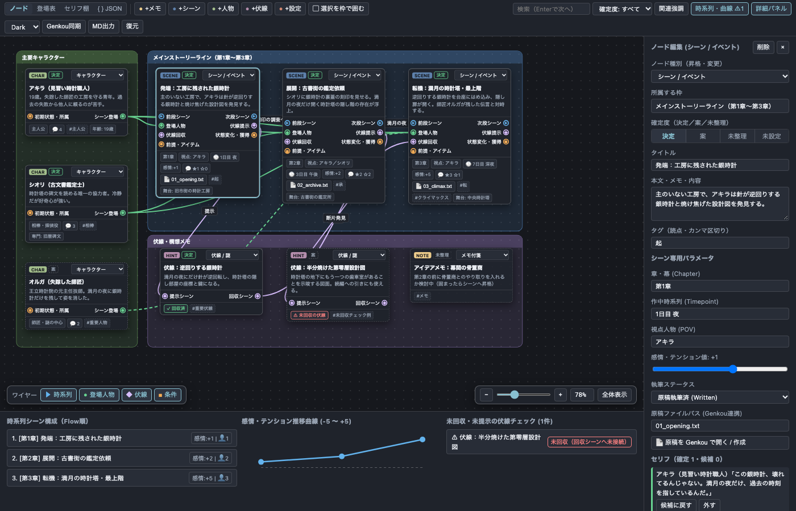
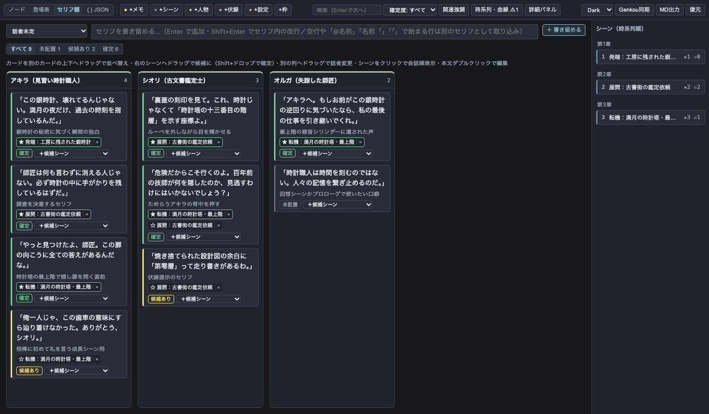
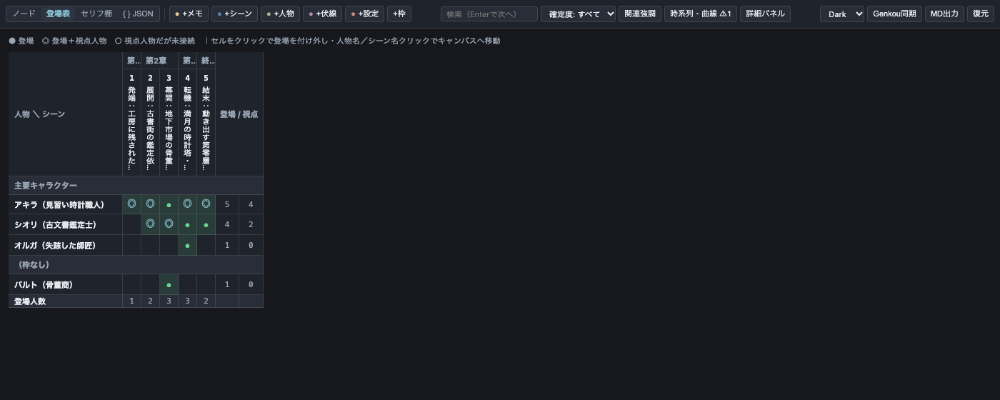

# Node Plot — 物語プロット＆アイデア構築ノードエディタ for VS Code

**Node Plot (`node-plot`)** は、小説・シナリオの構想やアイデアを「付箋（ノード）」として書き溜め、**名前付き・型付きの複数入出力ソケット（時系列フロー・登場人物・伏線の提示と回収・前提条件）** とパラメータで視覚的に接続・検証できる VS Code 拡張機能です。

未回収伏線の自動チェック、感情テンション推移曲線、キャラクター×シーンの**登場表**、思いついたセリフを書き溜めて後からシーンへ配置できる**セリフ棚**を備え、原稿用紙エディタ **Genkou Sheet (`genkou-sheet`)** ともシームレスに連携します。



---

## 主な特徴 (Features)

### 1. 「付箋の手軽さ」と「マルチソケット構造化」の両立
* キャンバス上のダブルクリックで、ソケットを持たない軽量な **「メモ付箋 (`note`)」** を即座に配置できます。
* アイデアが固まったら、カード右上のプルダウンからワンクリックで **「シーン (`scene`)」「キャラクター (`character`)」「伏線・謎 (`foreshadow`)」「設定・アイテム (`world_item`)」** へ昇格でき、種別に応じた標準ソケットが自動付与されます。
* 各ノードに **確定度（決定＝実線 ／ 案＝破線 ／ 未整理＝点線）** を設定でき、構想中の案と確定した展開を見分けながらツールバーで絞り込めます。

### 2. 4種類の型付きソケットと接続保護
* **`▶ 時系列・因果フロー (flow)`**: シーン間の前後関係や IF ルート分岐（実線・破線）
* **`● 登場人物 (character)`**: キャラクターノードから登場する各シーンへの参加接続
* **`◆ 伏線・謎 (foreshadow)`**: 伏線を張るシーン（出力）から伏線ノードを経由し、回収するシーン（入力）へ接続
* **`■ 条件・アイテム・状態 (item)`**: キーアイテムや世界観ルール、状態変化の受け渡し
* 互換性のないソケット同士は誤接続されないよう自動検証されます。また、任意のカスタムソケット端子や `Key: Value` パラメータを自由に追加できます。

### 3. 未回収伏線チェッカー・テンション曲線・関連トレース
* 提示されたまま回収シーンに繋がっていない伏線を **「⚠ 未回収の伏線」** として自動検出し、ノード上および下部ドロワー・サイドバーで警告表示します。
* 各シーンの感情・テンション値（`-5` 〜 `+5`）を時系列トポロジカルソート順に並べた **テンション推移曲線** をリアルタイム描画します。
* ツールバーの **「関連強調」** をオンにすると、選択した人物や伏線に直接・間接的に繋がるノードとワイヤーのみをハイライト表示します。

### 4. セリフ棚（書き溜めセリフの管理と会話順並べ替え）
* プロットが固まったら、各キャラクターが言いそうなセリフを、どのシーンに入るか決めないまま書き溜められます。
* `@名前 本文`・`名前「本文」`・`名前：本文` 形式での複数行一括貼り付けにも対応（末尾の `// メモ` や `（メモ）` はメモ欄へ自動格納）。
* セリフカードを右側のシーンへドラッグして **「☆ 候補」** に、`Shift + ドロップ`（または候補チップのクリック）で **「★ 確定」** に配置できます。
* カードの上下ドラッグで順番を並べ替えられ、シーンをクリックして絞り込むと**話者混在の1列（会話順）**で掛け合いの流れを組み立てられます。
* コマンド `Node Plot: セリフを書き留める` を使えば、原稿の執筆中でもキャンバスを開かずにセリフを書き留められます。



### 5. 登場表ビュー（キャラクター × シーン）
* 誰がどのシーンに登場し（`●`）、誰の視点（POV）で語られるか（`◎`）を時系列順のマトリクスで一覧できます。
* セルをクリックするだけで登場（人物ワイヤー）を付け外しできるため、キャンバス上に大量の人物ワイヤーを引かずに登場バランスや長期不在区間を把握できます。



### 6. 色付き・入れ子のグループ枠
* グループ枠に 8 色の塗り色を設定でき、枠の中に枠を置くと入れ子になります（例：「登場人物」枠の中で「組織A」「組織B」に束ねる）。
* 枠を動かすと中身（子枠・ノード）がまとめて追従します。辺や角のドラッグでリサイズでき、「選択を枠で囲む」「中身に合わせてサイズ調整」にも対応しています。

### 7. `Genkou Sheet` 連携と構成案（Markdown）出力
* 各シーンノードに原稿ファイルパス（例：`01_opening.txt`）を設定し、ノード上のボタンから直接 **Genkou Sheet（原稿用紙エディタ）** で原稿を開いたり新規作成したりできます。
* 時系列順のシーン構成（確定・候補セリフ付き）・登場人物・伏線チェックリストをまとめた **Markdown 構成案の出力**、および `.genkou.json` の原稿順序リストへのワンクリック同期に対応しています。

### 8. 自動バックアップと2画面キャンバス比較復元
* 編集から約1.5秒後に、プロットを VS Code の拡張機能専用領域へ自動バックアップします（5分ごとに世代を分け、1ファイルあたり最大50世代保持）。プロジェクトフォルダーや Git の差分は汚しません。
* `Node Plot: 自動バックアップからプロットを復元` から、**プロットキャンバス2画面の並列表示（左右連動パン・ズーム＆変更ノード強調）** または **JSONテキスト差分** で比較して安全に復元できます。

---

## クイックスタート (Quick Start)

1. VS Code で執筆・プロット用のフォルダーを開きます。
2. コマンドパレット（`Cmd+Shift+P` / `Ctrl+Shift+P`）を開き、以下を実行します：
   ```text
   Node Plot: このフォルダーをプロットプロジェクトとして有効化
   ```
   （または `Node Plot: 新規プロットファイル (.nplot) を作成` を実行します）
3. サンプルの `.nplot` ファイルがノードキャンバス画面で開きます。
   * 専用拡張子 `*.nplot` のみを対象とするため、既存の `.json` や `.md`、他のプログラミング用プロジェクトには一切干渉しません。

---

## 使い方・操作一覧 (Usage)

### キャンバス・マウス＆キーボード操作

| 操作 | 方法 |
| :--- | :--- |
| 新規メモ付箋の作成 | キャンバスの背景（または枠内）を**ダブルクリック** |
| ノード同士の接続 | 右側の出力端子（`▶` `●` `◆` `■`）から左側の同型入力端子（またはカード本体）へ**ドラッグ＆ドロップ** |
| キャンバス移動（パン） | 背景をドラッグ ／ マウス中ボタンドラッグ ／ トラックパッド2本指スクロール |
| ズーム（セマンティックズーム） | マウスホイール ／ 右下のズームスライダー・`全体表示` ボタン |
| 複数選択 | `Shift` + 背景ドラッグ（範囲選択） ／ `Shift` または `Cmd` (`Ctrl`) + クリック |
| タイトル・枠見出しの編集 | ノードのタイトルや枠の見出しを**ダブルクリック** |
| サイズ変更 | 枠の辺・角をドラッグ ／ ノードカードの右端をドラッグ（ダブルクリックで標準幅にリセット） |
| コピー・切り取り・貼り付け | `Cmd+C` / `Cmd+X` / `Cmd+V`（Windows・Linux は `Ctrl`）。プレーンテキストを貼り付けると新規メモ付箋になります |
| 複製・全選択・選択解除 | `Cmd+D`（複製） ／ `Cmd+A`（全選択） ／ `Esc`（選択解除） |
| 削除 | `Delete` または `Backspace` |
| 元に戻す・やり直し | `Cmd+Z` / `Cmd+Shift+Z`（VS Code 標準の Undo / Redo と完全統合） |

> パン・ズームや表示モードの切り替えはファイルを変更しないため、眺めるだけでファイルが「未保存（Dirty）」になることはありません。

### コマンド一覧

| コマンド | 説明 |
| :--- | :--- |
| `Node Plot: このフォルダーをプロットプロジェクトとして有効化` | 現在のフォルダーでプロット構成ツリーを有効化し、初回サンプルプロットを作成します |
| `Node Plot: プロットプロジェクト設定を解除` | このフォルダーのプロットプロジェクト設定を解除します |
| `Node Plot: 新規プロットファイル (.nplot) を作成` | 新しい `.nplot` ファイルを作成してノードエディタで開きます |
| `Node Plot: セリフを書き留める` | キャンバスを開かずに話者を選んでセリフを連続入力します（原稿執筆中のひらめきメモに最適） |
| `Node Plot: 時系列順の構成案 (Markdown) を書き出し` | 時系列順のシーン構成・人物・伏線チェックリストを `.md` ファイルに出力します |
| `Node Plot: シーン順序を Genkou Sheet (.genkou.json) へ同期` | 時系列フロー順の原稿ファイルリストを `.genkou.json` に反映します |
| `Node Plot: 自動バックアップからプロットを復元` | 自動保存されたバックアップ世代から2画面キャンバス比較・差分確認・復元を行います |
| `Node Plot: JSONテキスト表示に切り替え` / `ノード表示に切り替え` | エディタ右上のボタンから標準 JSON テキストエディタとノードエディタを行き来できます |

---

## 設定一覧 (Configuration)

| 設定キー | 説明 | デフォルト値 |
| :--- | :--- | :--- |
| `nodePlot.enabled` | 現在のワークスペースでプロットプロジェクト機能を有効にするか | `false` |
| `nodePlot.theme` | プロットキャンバスのカラーテーマ（`dark` / `light` / `sepia`） | `"dark"` |
| `nodePlot.snapToGrid` | ノード移動時にグリッドへスナップするか | `true` |
| `nodePlot.gridSize` | キャンバスのグリッド間隔（px、`8` 〜 `64`） | `20` |
| `nodePlot.backup.enabled` | 編集中の `.nplot` ファイルを拡張機能専用領域へ自動バックアップするか | `true` |
| `nodePlot.backup.intervalMinutes` | 新しいバックアップ世代を作る間隔（分） | `5` |
| `nodePlot.backup.maxSnapshots` | 1ファイルあたり保持するバックアップ世代数 | `50` |

---

## 既知の制限 (Known Limitations)

* マルチルートワークスペースでは、最初のフォルダーだけがプロットプロジェクトおよび `Genkou Sheet` 同期の対象になります。
* 制限モード（Restricted Mode）の信頼されていないワークスペースでは、拡張機能は無効になります。
* サイドバーの「プロット構成・伏線一覧」ツリーは保存済みの `.nplot` ファイルおよびアクティブなプロットから集計します。

---

## ライセンス (License)

MIT License

不具合の報告・ご要望は [GitHub Issues](https://github.com/moha358/node_plot/issues) へお寄せください。
