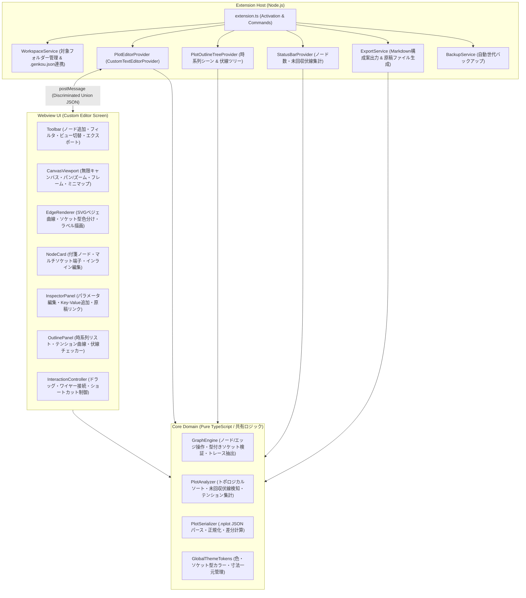

# アーキテクチャ・技術仕様書 (Architecture Specification)

## 1. システム全体構成

本拡張機能は **Extension Host（Node.js / TypeScript）**、**Core Domain（環境非依存の純粋 TypeScript）**、**Webview UI（ブラウザ環境 / TypeScript + HTML/CSS + SVG エッジレイヤー）** の3層で構成され、`genkou_sheet` と統一されたクリーンアーキテクチャを採用する。



---

## 2. ディレクトリ構造（実装時のターゲット構成）

```text
node_plot/
├── AGENTS.md                        # マルチAIエージェント共通ガイドライン
├── .memory/                         # マルチAIオーケストレーション用永続メモリー
│   ├── project-context.md           # プロジェクト全体コンテキスト・不変ルール
│   ├── decisions.md                 # アーキテクチャ意思決定記録 (ADR)
│   ├── tasks.md                     # タスク分解・進捗・検証基準ボード
│   └── handoff.md                   # エージェント間引き継ぎ・最新状態ログ
├── docs/                            # ドキュメント格納ディレクトリ
│   ├── requirements/
│   │   └── requirements.md          # 要件定義書
│   ├── specs/
│   │   ├── architecture.md          # アーキテクチャ仕様書（本ファイル）
│   │   ├── node-graph-and-plot.md   # ノードグラフ・ソケット・物語プロット仕様書
│   │   └── publishing.md            # Marketplace・GitHub公開仕様書
│   └── validation/
│       └── release-check.md         # 検証記録
├── src/
│   ├── extension.ts                 # 拡張機能エントリポイント
│   ├── core/                        # 環境非依存の純粋ロジック（単体テスト対象）
│   │   ├── types.ts                 # データモデル・ソケット型・通信メッセージ型定義
│   │   ├── theme.ts                 # グローバルテーマ定義（Design Tokens）・設定正規化
│   │   ├── graphEngine.ts           # ノード/エッジ操作・ソケット型互換性検証・接続トレース
│   │   ├── plotAnalyzer.ts          # 時系列ソート・未回収伏線検出・テンション曲線算出
│   │   └── serializer.ts            # .nplot JSON シリアライズ・マイグレーション・最小置換差分
│   ├── providers/                   # VS Code API 連携層
│   │   ├── plotEditorProvider.ts    # CustomTextEditorProvider 実装
│   │   ├── plotOutlineTreeProvider.ts # サイドバー TreeDataProvider 実装
│   │   └── statusBarProvider.ts     # StatusBarItem 制御
│   ├── services/                    # ワークスペース操作・外部連携サービス
│   │   ├── workspaceService.ts      # 対象フォルダー初期化・解除 (.nplot.json)
│   │   ├── backupService.ts         # プロットの自動バックアップ（世代管理）
│   │   └── exportService.ts         # Markdown構成案出力・原稿ファイル生成・genkou_sheet連携
│   └── webview/                     # Webview フロントエンド実装
│       ├── index.ts                 # Webview エントリ
│       ├── components/              # 疎結合UIコンポーネント群
│       │   ├── Toolbar.ts           # 上部ツールバー（ノード追加・検索・ビュー切替）
│       │   ├── CanvasViewport.ts    # 無限キャンバス・ズーム/パン・フレーム・ミニマップ
│       │   ├── EdgeRenderer.ts      # SVGベジェ曲線ワイヤー描画レイヤー
│       │   ├── NodeCard.ts          # 付箋ノード＆マルチソケット端子描画
│       │   ├── InspectorPanel.ts    # 右サイド属性・パラメータ編集パネル
│       │   ├── OutlinePanel.ts      # 時系列アウトライン・テンション曲線・伏線一覧パネル
│       │   └── InteractionController.ts # ポインタ操作・接続ドラッグ・ショートカット制御
│       └── styles/
│           └── globalTheme.css      # CSS Variables による一元管理スタイル
└── test/                            # 自動テスト
    ├── core/
    │   ├── graphEngine.test.ts
    │   ├── plotAnalyzer.test.ts
    │   └── serializer.test.ts
    └── build/
        └── bundle.test.cjs
```

---

## 3. 対象フォルダー限定の動作制御と `genkou_sheet` 共存仕様

1. **専用拡張子 `.nplot` による安全な分離:**
   * プロットファイルは専用拡張子 `*.nplot` を使用する（中身は2スペースインデントの UTF-8 JSON）。
   * これにより、一般的な開発プロジェクトの `*.json` や `*.md` を誤ってカスタムエディタで開く事故を構造的に防止する。
2. **プロジェクト設定ファイル `.nplot.json` と `.genkou.json` の協調:**
   * `Node Plot: このフォルダーをプロットプロジェクトとして有効化` を実行すると `.nplot.json` を作成し、サイドバーのプロット構成ツリーを表示する。
   * 同じフォルダー内に `genkou_sheet` の `.genkou.json` が存在する場合、シーンノードの `manuscriptPath`（例：`chapters/01.txt`）をクリックすると `genkou_sheet` の原稿用紙エディタで該当原稿を直接開くことができ、プロット順の変更を `.genkou.json` の原稿順序へ同期できる。

---

## 4. Extension Host ⇔ Webview メッセージングプロトコル

型安全な判別共用体（Discriminated Unions）で通信を行う。

### Host → Webview (`HostToWebviewMessage`)
* `INIT_DOCUMENT`: `{ type: 'INIT_DOCUMENT', document: PlotDocument, config: PlotConfig, version: number, fileName: string }`
* `DOCUMENT_CHANGED`: `{ type: 'DOCUMENT_CHANGED', document: PlotDocument, version: number }`（Undo/Redo や外部変更時）
* `EDIT_RESULT`: `{ type: 'EDIT_RESULT', version: number, accepted: boolean }`
* `CONFIG_CHANGED`: `{ type: 'CONFIG_CHANGED', config: PlotConfig }`
* `FOCUS_NODE`: `{ type: 'FOCUS_NODE', nodeId: string }`（サイドバーツリーから特定ノードへジャンプ時）
* `PARSE_ERROR`: `{ type: 'PARSE_ERROR', message: string, version: number, fileName?: string, config?: PlotConfig }`（`.nplot` の JSON が壊れている場合。`INIT_DOCUMENT` / `DOCUMENT_CHANGED` の代わりに送る。Webview はオーバーレイを表示して `UPDATE_DOCUMENT` を送らない。サンプルドキュメントへのすり替えによる上書き事故を防ぐ）

> **パン・ズームの扱い（ADR-006）:** パン・ズーム・ワイヤー表示切替・パネル開閉は Webview の `setState` に保存し、それ単独では `UPDATE_DOCUMENT` を送らない（ファイルを「変更あり」にせず Undo 履歴も汚さない）。`viewport` は他の編集と一緒にファイルへ書かれる。`DOCUMENT_CHANGED` 受信時は現在の視点を維持する。

### Webview → Host (`WebviewToHostMessage`)
* `READY`: `{ type: 'READY' }`
* `UPDATE_DOCUMENT`: `{ type: 'UPDATE_DOCUMENT', document: PlotDocument, version: number }`
* `UPDATE_VIEWPORT`: `{ type: 'UPDATE_VIEWPORT', viewport: ViewportState }`（パン・ズーム位置の保存）
* `UPDATE_CONFIG`: `{ type: 'UPDATE_CONFIG', partialConfig: Partial<PlotConfig> }`
* `OPEN_MANUSCRIPT`: `{ type: 'OPEN_MANUSCRIPT', nodeId: string, manuscriptPath: string, createIfMissing: boolean }`
* `REQUEST_EXPORT`: `{ type: 'REQUEST_EXPORT', format: 'markdown' | 'sync_genkou' }`

---

## 5. グローバルテーマ設計 (Global Theme Management)

コンポーネント内での色・フォント・寸法の直書き（ハードコード）を禁止し、`src/core/theme.ts` および `src/webview/styles/globalTheme.css` の CSS カスタムプロパティ（Design Tokens）で一元管理する。

| カテゴリ | トークン例 | 説明 |
| :--- | :--- | :--- |
| **Canvas & Surface** | `--nplot-canvas-bg`, `--nplot-canvas-grid-dot`, `--nplot-panel-bg`, `--nplot-card-bg`, `--nplot-frame-bg` | キャンバス背景、ドットグリッド、ノードカード、サイドパネルの背景色（Light / Dark / Sepia テーマ対応） |
| **Node Category Colors** | `--nplot-node-note`, `--nplot-node-scene`, `--nplot-node-character`, `--nplot-node-foreshadow`, `--nplot-node-item` | 5種類のノード種別ごとのヘッダー・アクセントカラー |
| **Socket & Wire Colors** | `--nplot-socket-flow`, `--nplot-socket-character`, `--nplot-socket-foreshadow`, `--nplot-socket-item` | B案の4種のソケット型（時系列・人物・伏線・条件アイテム）に対応する端子色・ベジェ曲線色 |
| **Status & Alert** | `--nplot-status-unresolved`, `--nplot-status-resolved`, `--nplot-highlight-glow`, `--nplot-dim-opacity` | 未回収伏線の警告色、関連トレース時のハイライト発光・非関連ノードの減光率 |
| **Typography & Spacing** | `--nplot-font-sans`, `--nplot-font-mono`, `--nplot-node-width`, `--nplot-socket-size`, `--nplot-radius-md`, `--nplot-shadow-card` | フォントファミリー、ノード標準幅、ソケット端子径、角丸、ドロップシャドウ |
